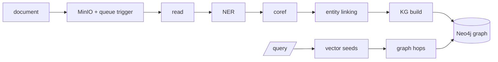
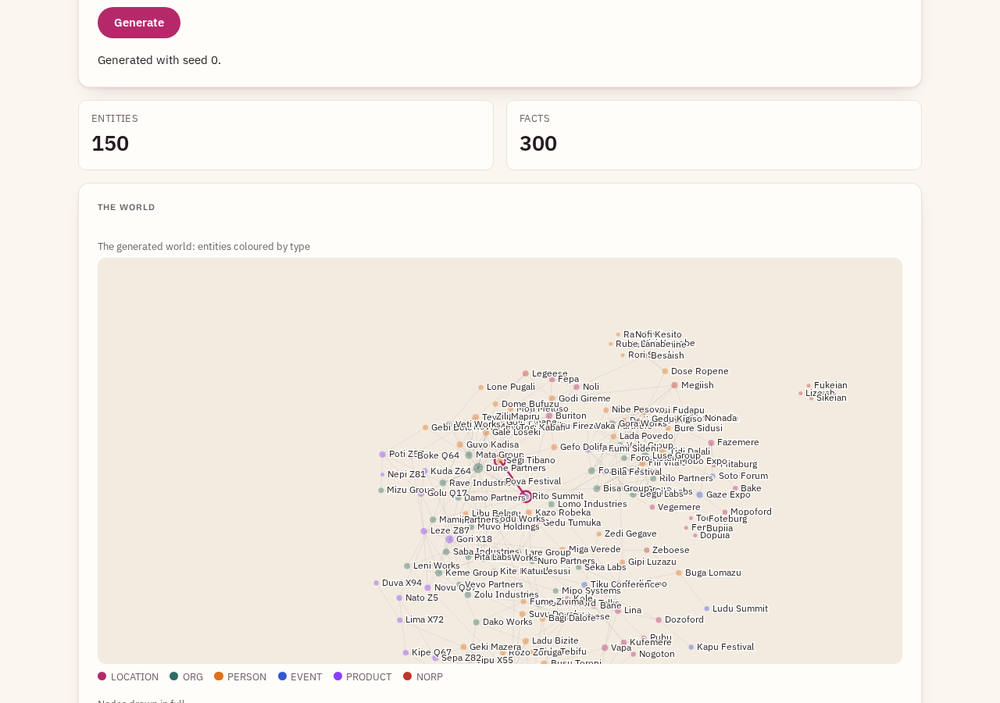

# Graph RAG Demo

A local Graph RAG pipeline that turns a pile of text and Markdown files into a
knowledge graph you can ask multi-hop questions against. Drop a document into
object storage, and a queue-triggered pipeline reads it, pulls out the people,
organisations, places and events, works out which mentions refer to the same
thing, links those to a corpus-wide identity, and writes the relationships into
Neo4j. Then you query the graph.

It runs entirely on one machine through Docker Compose. There's no external
knowledge base, no cloud dependency beyond an optional LLM API, and the default
query path never calls an LLM at all.

There's a visual walkthrough of the whole idea at
**<https://leejianrong.github.io/graph-rag-demo/>**.

**Starting on a new machine, or picking the work up?** Read [docs/HANDOFF.md](docs/HANDOFF.md): setup,
tests, the stack, the current state and known gaps, and every file that is not in git.

## Status

The pipeline is built and runs end to end. It came together in eight vertical
slices, from the ingest-and-store skeleton through NER, coreference, entity
linking, graph building, and retrieval, to a small benchmark harness. All eight
have landed. You can bring the whole stack up with one command, feed it
documents, and query the resulting graph; jump to [Running it
locally](#running-it-locally) for that.

It's now being shaped toward a product: a memory and knowledge store that agents
and developers use through an HTTP API (`/v1`), an MCP server, a CLI and a web UI, all built. Tenancy and API
keys exist (off by default), there is an independent evaluation bench ([Benchmarking](#benchmarking)),
and ingest runs through a Valkey stream with separate workers. Still open: a Python SDK, a staging
deployment, and quality on the real stack at scale. [Conventions](#conventions) has the summary and
[docs/HANDOFF.md](docs/HANDOFF.md) the details.

The design was written down before the code, and it's worth reading if you want
the reasoning rather than just the moving parts. The [PRD](docs/PRD.md), the
[ADRs](docs/adr/), and the [slice plan](docs/SLICES.md) cover it. Where a doc and
the code disagree, trust the code.

## The problem

Say you're watching a stream of news articles and reports, and the connection
you care about isn't stated in any single document. Supplier A is mentioned in
one file as being based in Berlin. Another file, written months earlier by
someone else, notes that a German supply-chain law applies to companies in
Berlin. No one document links the supplier to the law, but the graph does, in
two hops.

Ordinary vector RAG struggles here. It retrieves the paragraphs that mention
your search terms and hands them to a model, but the paragraphs that matter
might share no keywords with your question or with each other. The link lives in
the *structure* between documents, which is exactly what a knowledge graph
captures and a bag of text chunks throws away.

## How it works



Ingestion is one in-process consumer that runs five stages for each document,
in order. Keeping it in a single process was a deliberate choice: for a
local demo, being able to trace one document through the whole flow in one
stack trace beats the independent scaling you'd get from wiring five services
together with intermediate queues. Each stage is still a separate,
swappable module, so the microservices version stays possible later without a
rewrite.

1. **Read.** A queue message carries a bucket and object key, nothing more. The
   stage fetches that file from MinIO. The raw text is stored in Elasticsearch
   up front, keyed by a deterministic document ID, before any processing runs.
2. **NER.** spaCy extracts typed mentions locally: people, organisations,
   locations, dates, events. This runs on your CPU and costs nothing per token,
   which matters because it touches every word of every document.
3. **Coreference.** An LLM groups the mentions within a single document that
   refer to the same thing, pronouns included, and returns a cluster map rather
   than rewriting the text. The original characters stay put, so provenance
   offsets stay valid.
4. **Entity linking.** Each cluster is matched against a corpus-local store of
   canonical entities: blocked by type and normalised name, scored by embedding
   similarity, then either merged into an existing entity or created as a new
   one. This is the step that lets "Angela Merkel" in one file and a later
   mention in another become a single graph node. There's no Wikidata, no
   external KB. The corpus is its own authority, and linking is order-sensitive:
   the first document to mention an entity seeds its record.
5. **Knowledge-graph build.** An LLM reads the document and its linked entities
   and emits subject–predicate–object triples grounded in canonical entity IDs.
   Predicates map to a closed set of about twelve relations (`LOCATED_IN`,
   `WORKS_FOR`, `FOUNDED`, and so on) with a `RELATED_TO` fallback that keeps
   the model's original phrasing so nothing is lost. Every edge records where it
   came from: source document, sentence, and the sentence text itself.

Dates are the one type that doesn't become a node. A graph full of date nodes
turns into a hairball, so a date rides along as an attribute on the edge it
qualifies instead.

## Answering without an LLM

Retrieval and synthesis are two different jobs, and conflating them is what
makes most Graph RAG demos quietly expensive. Finding the right entities and
evidence for a question can be done with embeddings and graph traversal alone.
Only turning that evidence into fluent prose actually needs a language model.

So the default query path uses no LLM and costs nothing. It embeds your
question, finds seed nodes by vector search over entity and passage embeddings
in Elasticsearch, expands a few hops out in Neo4j, and returns a ranked subgraph
with the supporting sentences and their provenance. For a question whose answer
is an entity, the answer is the top-ranked node.

That path answers "who" and "where" questions well and explanatory ones poorly,
which is an honest limitation rather than a bug. When you want prose, an
optional synthesis mode feeds the retrieved subgraph to an LLM. It's gated off
by default.

## Running it locally

In a hurry? [docs/QUICKSTART.md](docs/QUICKSTART.md) runs the service in one process with no Docker or LLM key (heuristic extraction) and connects Claude Code to it. What follows is the full stack.

You'll need Docker with Compose, and an LLM for ingest (see below).

**What needs an LLM.** Ingest does: coreference and fact extraction call one, so `POST /ingest` and
`POST /v1/remember` need a provider key or an endpoint. With neither configured they answer `503`
(`unavailable`, `details.reason` `llm_not_configured`) and store nothing. Reading does not: `/query`,
`/v1/recall`, `/v1/lookup`, `/v1/forget`, deleting a document and the offline server (`graph-rag-offline`,
`make demo-offline`, heuristic stages) all work with no LLM. Give ingest one of three ways:

- **A provider key**: set `OPENAI_API_KEY` in `.env` (the default models are `gpt-4o-mini`; other
  LiteLLM model names via `COREF_MODEL` and `KG_BUILD_MODEL`, with that provider's key variable).
- **Any OpenAI-compatible endpoint**: set `OPENAI_API_BASE` (a hosted provider, or a local server such as
  Ollama or vLLM; a dummy `OPENAI_API_KEY` is fine if the server ignores it).
- **semula**: a recording OpenAI-compatible server whose prompts are answered by an agent. It is for the
  bench and for agent-driven sessions, not an unattended local model.

Ingest costs about 1.6M prompt and 0.15M answer tokens per 1,000 short documents (about 43 words each), which is
$2.35 at Claude Haiku 4.5 list prices and $0.23 at the cheaper price row in
[docs/results/ingest-cost.md](docs/results/ingest-cost.md); those are computed from counted tokens, not billed.
Longer documents cost more. A repeated document is served from the response cache at no cost.
If a provider rejects the key or the endpoint is unreachable, the job fails with that reason (`GET /jobs/{id}`).

```bash
git clone https://github.com/leejianrong/graph-rag-demo
cd graph-rag-demo
cp .env.example .env          # then set OPENAI_API_KEY — see below
docker compose up --build     # or: make up (bare `make` lists every command)
```

The first build is large and slow. The image installs PyTorch and downloads
spaCy's transformer model and the bge embedding model, which runs to a few
gigabytes; after that it's cached. Compose brings up Valkey (the ingest queue), MinIO, Elasticsearch,
Neo4j, and the FastAPI service on port 8000. The MinIO console is on 9001 and the
Neo4j browser on 7474 if you want to poke at the stores directly. The web UI is served by the same
service: open http://localhost:8000/ and sign in with an API key (see [Quickstart](docs/QUICKSTART.md)).

Ingest a document with a multipart upload:

```bash
curl -F "file=@some-report.md" http://localhost:8000/ingest
# {"document_id": "...", "bucket": "documents", "object_key": "some-report.md", "status": "accepted"}
```

`/ingest` takes a text file, a PDF or an HTML page, or `-F url=https://...` instead of a file: the URL is fetched by the service (public addresses only, including after redirects; at most `MAX_UPLOAD_BYTES`, 10 s) and the URL is the source's identity. PDFs and pages are stored as their text; a source with no extractable text (an empty file or an empty `/v1/remember` text included), an unreadable PDF or a failed fetch is a 422 and nothing is stored. Crawling is not supported.

An upload over `MAX_UPLOAD_BYTES` (default 10 MB) is refused with 413 and nothing is stored. With `REQUIRE_AUTH` on, each key may make `RATE_LIMIT_PER_MINUTE` requests a minute (default 600) and each address `FAILED_KEY_LIMIT_PER_MINUTE` failed ones (default 20); past either the answer is 429 with `Retry-After` (`rate_limited` on `/v1`), and one key's traffic never counts against another's. Ingestion is asynchronous. `/ingest` writes the file to MinIO, publishes a
trigger (a Valkey stream entry by default, a Kafka message with `TRIGGER_BACKEND=kafka`), and returns straight away; the consumer then runs the five stages. Follow
it with `docker compose logs -f worker` (the worker runs the stages in compose); `make logs` tails only the `app` service. In compose the API only publishes and the `worker` service consumes: `docker compose up -d --scale worker=3` adds workers (any number with the default Valkey queue; each loads the NER model and embedder, so budget memory). With `METER_USAGE` on, the API and the workers write one usage file on a shared volume. The queue is Valkey by default (`TRIGGER_BACKEND=redis`). Kafka stays available: `TRIGGER_BACKEND=kafka docker compose --profile kafka up`, where workers help up to `INGEST_PARTITIONS` (default 4) (ADR-0016). Outside compose the API runs the consumer itself unless `INGEST_MODE=publish`, which then needs `graph-rag-worker` running.

A source is keyed by its filename, or by `-F source_url=https://...` when you give one. Posting the
same source with the same bytes again returns `"status": "unchanged"` and does nothing: no write, no
trigger, so no pipeline run and no LLM call. The exception is a source whose last job `failed`: posting it
again queues it again and answers `"status": "accepted"` (counted once in usage, not twice). A `queued`,
`running` or `done` source stays `unchanged`. Changed bytes are ingested again; add `?force=true` to
push identical bytes through anyway.

The agent API under `/v1` (contract: `docs/api/agent-api.openapi.yaml`, ADR-0014) takes JSON and answers
failures as `{"error": {"code", "message"}}`:

```bash
curl -X POST localhost:8000/v1/remember -H 'content-type: application/json' \
  -d '{"text": "Ada Lovelace works for Acme Corp.", "source_id": "note-1"}'   # 202, status accepted
curl -X POST localhost:8000/v1/recall -H 'content-type: application/json' \
  -d '{"question": "Who works for Acme Corp?"}'                              # answer + evidence
curl -X POST localhost:8000/v1/forget -H 'content-type: application/json' -d '{"source_id": "note-1"}'
```

`remember` and `/ingest` take an optional `document_date` (`YYYY-MM-DD`): the facts taken from that document start being valid on it, and are returned with `valid_from` and `valid_to` (null when unknown).

`remember` and `/ingest` return a `document_id`, and `GET /jobs/<document_id>` says where that document is: `queued`, `running`, `done` or `failed` (a failure names the stage and the error type; the detail is in the service log). `GET /jobs/<document_id>/events` streams the same progress as server-sent events: one `stage` event per pipeline stage (`read`, `entity recognition`, `coreference`, `entity linking`, `knowledge graph`), then a final `done` or `failed` event carrying the job, after which the stream closes. With `INGEST_MODE=inline` (the default outside compose) jobs are held in the service's memory, so a restart forgets them; with `INGEST_MODE=publish` (both compose files) they live in Elasticsearch (`JOBS_INDEX`) and survive one. The counts `entities` and `edges` on a job are `null` until it is `done`.

Add `"namespace": "my-project"` to any of the three calls to keep memory apart (per project, say): what is
remembered in one namespace is never recalled or forgotten from another, and leaving it out is the default
namespace. `lookup` is served too, and `recall` takes `token_budget` and `as_of`.

To browse the graph (the explorer UI does), `GET /v1/entities?q=acme&type=ORG&limit=20` pages through entities by
name or alias, newest first (pass `next_cursor` back as `cursor`), and `GET /v1/entities/<canonical_id>` returns one
entity with its aliases, its outgoing and incoming facts (`neighbours_limit`, `sources_limit`) and the documents that
mention it, by id, name and mention count. Both take `namespace` and only ever see the caller's own tenant.

To fix a linking mistake, `POST /v1/entities/<keep_id>/merge` with `{"merge_ids": ["<id>", ...]}` (1 to 10 ids of the
same type, none the kept one) folds those entities into the kept one (GRA-144): it gains their names as aliases, their
edges and the documents' links move onto it, and they leave the entity store. The merge is recorded first, so it can be
undone later, and the entity detail lists it as `merged_from`. Repeating a merge is a no-op (`200`), an unknown or
other-tenant id is `404`, and entities of different types are `409`. A merged-away id answers `404` with
`details.merged_into`, and a later document that names it links to the kept entity.

A wrong merge can be undone: `POST /v1/entities/<keep_id>/split` with `{"merge_id": "<id>", "entity_ids": ["<id>"]}`
(`merge_id` is in the merge response and in `merged_from`; leave it out when the entity has one merge, and `entity_ids`
out to split all of it) puts the entities that merge folded in back with their edges, aliases, document links and
first-seen time (GRA-145). Only a recorded merge can be split: no merge to split, a merge that never finished, a
kept entity that was itself merged into another (split that one first) and a restored id that is taken again are `409`
with `details.reason`; an unknown or other-tenant id is `404`. Splitting twice is a no-op (`200`, `already_split`).
Edges, links and aliases the kept entity gained after the merge stay with it.

To ask what was true on a past day, give `remember` a `document_date` and `recall` an `as_of` (both `YYYY-MM-DD`; `graphrag remember --document-date`, `graphrag recall --as-of`). `recall` then drops the facts that had not begun or had ended by that day, and the entities and sentences that rest only on them. A fact with no known dates is never dropped, since the service only knows a date it was given. A newer dated document also ends an older fact for the predicates that hold one object at a time (`WORKS_FOR`, `LOCATED_IN`, `HAS_ROLE`, `GOVERNED_BY`): the older edge gets a `valid_to` and stays as history. `recall` without `as_of` leaves ended facts out; with `as_of` it finds them. Both need `document_date` on the documents, since only dated documents can be ordered.

### Command line

`graphrag` calls a running service's `/v1` API from a terminal (`uv sync --extra cli`). It reads
`GRAPH_RAG_URL` (default `http://localhost:8000`) and `GRAPH_RAG_API_KEY`:

```bash
graphrag remember "Acme Corp is based in London." --source-id note-1   # or --file notes.md, or stdin
graphrag recall "Where is Acme Corp based?"                           # the answer, then its sources
graphrag recall "Where is Acme Corp based?" --token-budget 500        # at most about 500 tokens of evidence
graphrag --json recall "Where is Acme Corp based?"                    # the API's JSON, for scripts
graphrag forget --source-id note-1
graphrag lookup --name "Acme Corp"                                    # aliases and neighbouring facts
```

Each command takes `--namespace`. Exit status is 0 on success, 1 when the service returned an error and 2 when it could not be reached.

### API keys

By default the service checks no key and every request runs in the default tenant. The sections below turn
that on and cover the operator settings around it.

**Observability** (off by default, GRA-56): `METRICS_ENABLED=true` serves Prometheus metrics at `/metrics` (and on the worker's health port): requests by route and status, latency, ingest stage time and failures, LLM calls and tokens by model, with no tenant, key or text in any label. With `REQUIRE_AUTH` on it needs `METRICS_TOKEN` as a bearer token; an API key is refused. Setting `OTEL_EXPORTER_OTLP_ENDPOINT` exports one trace per ingest, from the API request through the worker's stages and LLM calls to the graph write; `LOG_FORMAT=json` puts the trace id on each log line. `docker compose -f docker-compose.yml -f docker-compose.observability.yml up` adds Prometheus, a Grafana dashboard (http://localhost:3000) and Jaeger.

**Hosted:** `docker-compose.hosted.yml` is the stack for a deployment: no store publishes a port, every credential must be set, Elasticsearch has security on, auth is required and the API listens on 127.0.0.1 for a TLS proxy (header of the file has the steps). The service itself also refuses, with auth on, to start on a store credential that is still the local-dev value (`ALLOW_DEFAULT_CREDENTIALS=true` for staging).

With `REQUIRE_TENANT_LLM_KEY=true` (off by default) a named tenant's LLM calls use a key it brought: `graph-rag-keys llm-key set TENANT` reads it from stdin or a prompt and stores it encrypted under `TENANT_LLM_KEY_SECRET` (a Fernet key; `llm-key remove` and `list` too), and ingest for a tenant with none is refused with 400. The default tenant is unchanged.

With auth off, the service starts only on a loopback address; on any other it exits unless `ALLOW_OPEN_BIND=true` (the local compose stack sets it). Set `REQUIRE_AUTH=true` and every endpoint except `/health` needs `Authorization: Bearer <key>`; the key names the
tenant, and a key reaches only that tenant's memory. Keys live in the file `API_KEYS_PATH` (default
`.data/api-keys.json`; one service instance only):

```bash
uv run graph-rag-keys create acme --label laptop   # prints the key once; only its hash is stored
uv run graph-rag-keys list
uv run graph-rag-keys revoke <key_id>
```

A tenant can also manage its own keys over the API, with any of its live keys (GRA-143): `GET /v1/keys` lists
them (label, `key_id`, last four characters, status; never a secret), `POST /v1/keys` with `{"label": "..."}`
makes one and returns the secret once, and `DELETE /v1/keys/{key_id}` revokes one, which then gets `401` on its
next request. A tenant holds at most `MAX_KEYS_PER_TENANT` (10) active keys, may create `KEY_CREATE_LIMIT_PER_MINUTE`
(5) a minute, and cannot revoke the key a request used. With `REQUIRE_AUTH` off these answer `400`.

The MCP server sends `GRAPH_RAG_API_KEY` when it is set. `/docs` and `/openapi.json` stay open.

### Exporting and deleting a tenant

An operator can take a tenant's data out, or remove it from every store, with `graph-rag-admin` (it reads the
same `MINIO_*`, `ELASTICSEARCH_URL` and `NEO4J_*` settings as the service):

```bash
uv run graph-rag-admin show acme                    # what the tenant holds, per namespace
uv run graph-rag-admin export acme --out ./export   # documents, entities, graph and raw files, as files
uv run graph-rag-admin usage [acme]                 # with METER_USAGE=true: documents, queries, LLM tokens per tenant
uv run graph-rag-admin delete acme --yes            # without --yes it only shows; checks every store after
```

The export leaves out vectors (a re-ingest rebuilds them). The default tenant is refused, because data written
before tenancy existed carries no tenant.

### Use it from Claude Code (MCP)

`graph-rag-mcp` is an MCP server over stdio that exposes `remember`, `recall`, `forget` and `lookup` and calls a running
service's `/v1` API (it holds no pipeline of its own). Install the extra and register it:

```bash
uv sync --extra mcp
claude mcp add graph-rag --env GRAPH_RAG_URL=http://localhost:8000 -- uv run --directory "$PWD" graph-rag-mcp
```

`recall` returns the answer with its supporting sentences, each carrying its document and character
offsets, so the agent can cite them. The tools are `remember`, `recall`, `forget` and `lookup` (an entity with its aliases and neighbours); each takes an optional `namespace`.

To forget a document, delete it by the `document_id` that ingest returned:

```bash
curl -X DELETE http://localhost:8000/documents/<document_id>
# {"document_id": "...", "bucket": "documents", "object_key": "some-report.md",
#  "entities_removed": ["..."], "entities_kept": ["..."]}
```

It removes the document's edges, its record (so recall stops returning its sentences) and its
raw bytes. An entity that another document still mentions is kept; one that no other document
mentions is removed from the entity store and the graph. An unknown id is a 404. It runs in the
API process rather than through Kafka, and it does not guard against a delete racing the
consumer's processing of the same document.

Once a few documents are in, query the graph. This call makes no LLM request:

```bash
curl -X POST http://localhost:8000/query \
  -H 'content-type: application/json' \
  -d '{"question": "How is Supplier A connected to the German supply-chain law?"}'
```

You get back the connected subgraph, the supporting sentences with their
provenance, and the top-ranked entity as the predicted answer. Add
`"synthesize": true` to also get an LLM-written prose answer grounded in that same
evidence; that one does call the model.

### The bundled demo

If you'd rather not assemble a corpus by hand, there's a ready-made one under
[`examples/supply-chain/`](examples/supply-chain/) that reproduces the Supplier-A
story from the top of this README: three short documents where no single file
connects a company to the law that governs it, but the graph does, through the
city they share.

```bash
make demo-offline   # no Docker, no API key — deterministic, $0
make demo-live      # one command: brings the stack up, then runs the real demo
make demo           # the real stack over HTTP (needs a stack already up via `make up`)
```

All three ingest the same files and answer *"How is Aurelia Components connected to
the German Supply Chain Act?"*, then print the two-hop connection, the subgraph, and
the supporting sentences. `make demo-offline` runs the whole pipeline in-process
with heuristic stages instead of the LLM, so it needs nothing installed beyond the
Python deps and every edge is a generic `RELATED_TO`.

`make demo-live` is the self-sufficient real-stack path: it runs `docker compose up
-d --build --wait`, blocking until every service — including the app's own
healthcheck — is ready, then ingests and queries. You need Docker and an
`OPENAI_API_KEY` (or `OPENAI_API_BASE`) in `.env`: coreference and graph-building call an LLM, and
ingest is refused without one. It leaves
the stack **up** afterwards, so you can browse Neo4j at `localhost:7474`, re-run the
query cheaply with `make demo`, or stop everything with `make down`.

`make demo` is the fast inner loop: it drives a stack you already brought up (via
`make up` or `make demo-live`) without touching containers, so re-runs take seconds.
Edges are typed on both real-stack paths, and `SYNTHESIZE=1` (e.g. `make demo-live
SYNTHESIZE=1`) adds an LLM prose answer. It's the fastest way to see what the
pipeline is for before pointing it at your own documents.

### What to watch for

A few things trip people up the first time:

- **The graph needs an API key.** Coreference and graph-building go through an LLM.
  With no key set, those stages raise, and the pipeline logs the error and drops
  the document after its raw text is already stored. You end up with documents in
  Elasticsearch and an empty graph, which looks like nothing happened. Set
  `OPENAI_API_KEY` in `.env`, or point `COREF_MODEL` / `KG_BUILD_MODEL` at another
  OpenAI-compatible endpoint (DeepSeek included) and set that provider's key.
- **Multi-hop needs more than one document.** The whole point is connections that
  cross documents, so feed it a handful of related files rather than one. And
  because linking is order-sensitive, the ingestion order is part of the result.
- **Re-running is free.** Every LLM call is cached by a hash of the model, prompt,
  and parameters, so re-ingesting the same corpus or repeating a query costs
  nothing the second time.
- **Elasticsearch wants memory.** It runs single-node with security off for local
  use. If the container keeps exiting, it usually needs more RAM given to Docker.

The test layers and how to run them are in [CONTRIBUTING.md](CONTRIBUTING.md#tests).

## Web UI

`ui/` is a Vite + Svelte + TypeScript app over the HTTP API. It has sign-in, an ingest console, a query
playground, a graph explorer and API key management. Its client types are generated from
`docs/openapi.json`, which `make openapi` rewrites from the app (a fast test fails when it is stale).
Needs Node 22+. With the API on port 8000 (for example `graph-rag-offline`):

    make ui-install
    make ui-dev     # http://localhost:5173, proxies the API paths to :8000
    make ui-build   # type-check and build into ui/dist
    make ui-e2e     # browser test: sign in, ingest, query (needs `npx playwright install chromium`)

The API process serves `ui/dist` at `/` when `UI_DIR` points at it (the image sets this up; for
`graph-rag-offline` run `UI_DIR=ui/dist graph-rag-offline` after a build), with a Content-Security-Policy that
allows only the app's own files (the IBM Plex fonts are bundled, nothing loads from a CDN). `ui/` has its own
[README](ui/README.md).

## Synthetic data generator



Testing a graph pipeline needs data where you know the right answer. [`datagen/`](datagen/)
(command `kggen`, [ADR-0012](docs/adr/0012-standalone-data-generator.md)) builds a knowledge
graph from a seeded, declarative spec, then derives documents and multi-hop questions from it,
so the gold never depends on the pipeline under test. It knows nothing about graph-rag. It needs
no Docker, model or API key.

```bash
make ui                    # web UI: set the knobs and a seed, see the graph, browse questions
                           # with their gold paths, read documents, download the dataset zip
make world PRESET=small    # realized stats versus what the spec asked for
make fixtures              # regenerate the committed small and medium sets (datagen/fixtures)
make                       # lists every command
```

`make ui` uses a local [indah](https://github.com/leejianrong/indah) checkout at
`~/projects/abang-ai/indah-python-ui` when one exists (override with `INDAH=/path`). Without one, or with
`make ui INDAH=`, it runs against indah from PyPI; the graph view needs indah 0.12 or later, and
0.13.0 is on PyPI and has it (checked with `hasattr(indah, "Graph")`), so the checkout is no longer required.
It picks a free port itself; `PORT=8765` pins one. Documents are template text by default. An opt-in switch writes them with an LLM through
any OpenAI-compatible endpoint instead; it only runs when you click Render documents.

The command line does the same, and the same spec and seed always give the same output:

```bash
uv run kggen world generate --preset medium --out world.json   # also writes world.stats.json
uv run kggen world stats --preset medium                       # realized stats vs. the spec
uv run kggen questions generate --preset small --n 50 --hops 1:1,2:2,3:1 --out questions.json
uv run kggen scenario generate --preset small --out scenario.json  # updates, deletes, arrival orders + expected graph
uv run kggen docs generate --preset small --out docs.json      # template text, no LLM
# LLM-written text for any OpenAI-compatible endpoint; answers are cached, so a re-run needs no endpoint:
uv run kggen docs generate --preset tiny --renderer llm --model M --cache-dir DIR [--base-url URL]
uv run kggen export --spec spec.json --out dataset.zip         # world + questions + documents + specs, reproducible
```

Presets run from `tiny` to `stress` (50,000 entities). You control how complex the graph is (size,
type and relation mix, hub-heavy versus uniform degrees, communities, cycles). Beyond graph shape,
a spec can add ambiguity (`alias_rate`, `homonym_rate`, `distractor_rate`, `noise_rate`) and temporal
churn (`churn_rate`, `retraction_rate`, with `start_year` and `end_year`); all default to off, and
every generated world is checked against its spec in the stats report. Questions run 1 to 4 hops and
carry the ids of the facts that answer them; documents record which sentence expresses which fact
and where each entity is mentioned, so scoring has exact gold. Scenarios add facts that change, are
forgotten, or arrive in any order, with the graph a memory store should end up with.
[`datagen/fixtures/`](datagen/fixtures/README.md) holds committed small and medium sets, and
[`datagen/examples/llm-cache-tiny/`](datagen/examples/llm-cache-tiny/README.md) a cached
LLM-written set for the tiny preset, and
[`datagen/examples/hard-small/`](datagen/examples/hard-small/README.md) a harder one (`--style rich`: merged facts,
background prose, more ambiguity) written by Haiku through semula.

## Benchmarking

The pipeline is evaluated on **2WikiMultihopQA**, whose evidence is expressed as
`(entity, relation, entity)` reasoning paths. That's a close match for what the
graph builds, which makes it a fair test of both construction and retrieval. A
fixed subset keeps runs quick, and the harness is a console command:

```bash
uv run kgbench run --subset small --dataset path/to/2wiki.json
# or, over the in-repo mini fixture: make benchmark
```

For long-term chat memory, `uv run kgbench run --dataset longmemeval` (or `make longmemeval`) scores LongMemEval-style sessions per question type over a bundled synthetic fixture; see [docs/BENCH.md](docs/BENCH.md).

Every result, the table and the JSON alike, carries its wall time and the LLM calls and dollars behind it.

`make benchmark` runs the same thing against a small bundled fixture with no
arguments, so you can see the scorecard immediately; pass `DATASET=path/to/2wiki.json`
for the real corpus or `REAL=1` for the real adapter stack.

The metrics are deliberately non-LLM: supporting-fact precision, recall and F1
for whether retrieval surfaced the gold evidence, plus exact-match and token-F1
on the answer, scored against each node's name and its aliases under standard
normalisation. Corpus-local entity linking is order-sensitive, so benchmark runs
fix the ingestion order and the linking thresholds to stay reproducible. A warm
run reuses the pre-built graph and the response cache, so it costs about nothing.

### The evaluation bench

2WikiMultihopQA only measures the pipeline on someone else's questions. [`bench/`](bench/) (command
`kgbench`, [ADR-0011](docs/adr/0011-in-repo-evaluation-bench.md)) scores it on a synthetic world graph whose gold
the pipeline never touches: extraction and linking F1, retrieval per hop count against BM25 and dense baselines,
ingest-order sensitivity, complexity sweeps, typed-answer scoring and an optional LLM judge. Every result carries
its cost. On 1-hop questions every system does well; at 2 hops only graph-rag recovers whole paths (about 18% on the
base world), and at 3 and 4 hops nobody does. Offline graph-rag is a floor: the real stack's LLM-built graph is
unmeasured. A quality drop fails the build (`make gate`, floors in [`bench/kgbench/gate.json`](bench/kgbench/gate.json)).

```bash
make compare    # path@k and recall@k per hop count, every system
make gate       # the CI quality floors, about 15 seconds
```

Method, numbers and every command: [docs/BENCH.md](docs/BENCH.md).

## Where the design lives

The thinking is all written down, and it's worth reading before any code:

- **[docs/PRD.md](docs/PRD.md)** — the product requirements: problem, user
  stories, implementation and testing decisions, scope.
- **[docs/ARCHITECTURE.md](docs/ARCHITECTURE.md)** — topology, the six ports, the
  data model, and the stage/checkpoint flow, consolidated from the ADRs.
- **[docs/adr/](docs/adr/README.md)** — architecture decision records 0001 to 0017, one per major
  choice, each with the alternatives weighed and the reasoning kept. ADR-0017 (Postgres with pgvector in
  place of four stores) is a decision and a spike in [`spikes/pg_stores/`](spikes/pg_stores/README.md); nothing is
  migrated.
- **[docs/THREAT-MODEL.md](docs/THREAT-MODEL.md)** — what is protected, the threats, what mitigates each and what is still open, with the
  checklist before a hosted deployment.
- **[docs/SLICES.md](docs/SLICES.md)** — the eight vertical slices the build
  followed, each with its own test plan. PRD, SLICES, SHAPING and the other planning documents are
  history; the code and the ADRs are current.
- **[docs/HANDOFF.md](docs/HANDOFF.md)** — setup on a new machine, current state, and
  [what is not in git](docs/DATA-PROVENANCE.md).
- **[docs/BENCH.md](docs/BENCH.md)** and **[docs/TESTING.md](docs/TESTING.md)** — the evaluation bench with
  its results, and the test strategy.
- **[docs/research/](docs/research/)** — market and benchmark research: [question types](docs/research/question-types.md) and the
  [comparison with Zep, Mem0, Cognee and LightRAG](docs/research/memory-layer-comparison.md) and
  [positioning and a pricing hypothesis](docs/research/positioning-and-pricing.md).
- **[docs/CONTEXT.md](docs/CONTEXT.md)** — the glossary and decision register.
  Start here if a term is unfamiliar.

## Conventions

Python 3.12, dependencies managed with [uv](https://github.com/astral-sh/uv),
modular layout with type hints and docstrings throughout. English-only corpus.
Tenancy and API keys exist but are off by default (`REQUIRE_AUTH`); a hosted compose file and a
[threat model](docs/THREAT-MODEL.md) cover a deployment, though no staging environment exists yet. Re-ingesting
changed text replaces what the old text contributed, and the MCP server, CLI and web UI are built. The roadmap is on
the pandan board (`GRA-*` cards), not in the docs; [docs/HANDOFF.md](docs/HANDOFF.md) says how to read it.

## Contributing

Changes land through pull requests with the checks green; see [CONTRIBUTING.md](CONTRIBUTING.md).
`make check` runs the cheap ones locally.

## License

Apache License 2.0; see [LICENSE](LICENSE) and [NOTICE](NOTICE). The third-party Python packages it installs are
MIT, BSD, Apache-2.0, PSF or MPL-2.0, and the optional `embed` extra pulls in NVIDIA's CUDA libraries through torch under NVIDIA's own terms.
