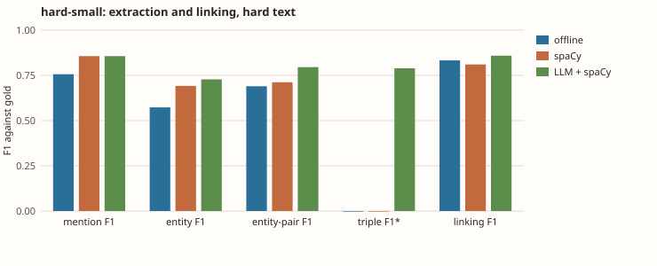
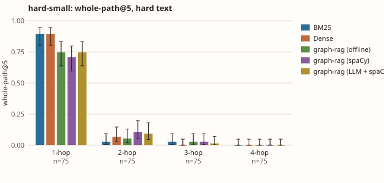

# hard-small: one world, two texts, several pipelines

`uv run --extra embed kgbench hard --dir datagen/examples/hard-small --questions 300 --embedder bge --k 5 --llm-cache bench/kgbench/data/llm-cache-hard-small --spacy en_core_web_sm --texts hard --pipelines offline spacy llm+spacy`; graph-rag with bge-small-en-v1.5 embeddings, one world, so the differences are one sample, not a distribution. `LLM` is the real coref and graph-build stages (Claude Haiku through semula, answers cached); `spaCy` is the real NER stage; the rest are the offline heuristics.

| | hard | hard + spaCy | hard + LLM + spaCy |
|---|---|---|---|
| words per document | 43 | 43 | 43 |
| mention F1 | 0.756 | 0.856 | 0.856 |
| entity F1 | 0.573 | 0.692 | 0.717 |
| entity-pair F1 | 0.690 | 0.712 | 0.806 |
| triple F1 (strict)* | n/a | n/a | 0.796 |
| linking F1 | 0.833 | 0.810 | 0.843 |

\* `n/a`: that pipeline's graph builder emits only the `RELATED_TO` fallback, so strict triple F1 is 0 by construction (drawn as 0 in the charts).





## Retrieval: hard

```
path@5 / recall@5, mean over seeds [0]
  hops  n     BM25                Dense               graph-rag passages  graph-rag graph   
  all   300   0.24 / 0.50         0.24 / 0.47         0.21 / 0.42         0.21 / 0.42       
  1     75    0.89 / 0.89         0.89 / 0.89         0.80 / 0.80         0.75 / 0.75       
  2     75    0.03 / 0.49         0.07 / 0.49         0.05 / 0.43         0.05 / 0.43       
  3     75    0.03 / 0.36         0.00 / 0.30         0.00 / 0.26         0.03 / 0.30       
  4     75    0.00 / 0.25         0.00 / 0.22         0.00 / 0.19         0.00 / 0.20       
```

## Retrieval: hard + spaCy

```
path@5 / recall@5, mean over seeds [0]
  hops  n     BM25                Dense               graph-rag passages  graph-rag graph   
  all   300   0.24 / 0.50         0.24 / 0.47         0.24 / 0.47         0.21 / 0.40       
  1     75    0.89 / 0.89         0.89 / 0.89         0.89 / 0.89         0.71 / 0.71       
  2     75    0.03 / 0.49         0.07 / 0.49         0.07 / 0.49         0.11 / 0.43       
  3     75    0.03 / 0.36         0.00 / 0.30         0.00 / 0.30         0.03 / 0.28       
  4     75    0.00 / 0.25         0.00 / 0.22         0.00 / 0.22         0.00 / 0.19       
```

## Retrieval: hard + LLM + spaCy

```
path@5 / recall@5, mean over seeds [0]
  hops  n     BM25                Dense               graph-rag passages  graph-rag graph   
  all   300   0.24 / 0.50         0.24 / 0.47         0.24 / 0.47         0.21 / 0.43       
  1     75    0.89 / 0.89         0.89 / 0.89         0.89 / 0.89         0.75 / 0.75       
  2     75    0.03 / 0.49         0.07 / 0.49         0.07 / 0.49         0.09 / 0.45       
  3     75    0.03 / 0.36         0.00 / 0.30         0.00 / 0.30         0.01 / 0.31       
  4     75    0.00 / 0.25         0.00 / 0.22         0.00 / 0.22         0.00 / 0.20       
```
