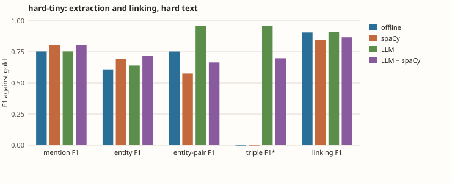
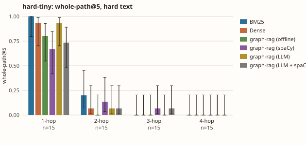

# hard-tiny: one world, two texts, several pipelines

`uv run --extra embed kgbench hard --dir datagen/examples/hard-tiny --questions 60 --embedder bge --k 5 --llm-cache bench/kgbench/data/llm-cache-hard-tiny --spacy en_core_web_sm`; graph-rag with bge-small-en-v1.5 embeddings, one world, so the differences are one sample, not a distribution. `LLM` is the real coref and graph-build stages (Claude Haiku through semula, answers cached); `spaCy` is the real NER stage; the rest are the offline heuristics.

| | template | hard | template + spaCy | hard + spaCy | template + LLM | hard + LLM | template + LLM + spaCy | hard + LLM + spaCy |
|---|---|---|---|---|---|---|---|---|
| words per document | 10 | 36 | 10 | 36 | 10 | 36 | 10 | 36 |
| mention F1 | 0.985 | 0.753 | 0.907 | 0.804 | 0.985 | 0.753 | 0.907 | 0.804 |
| entity F1 | 0.827 | 0.610 | 0.784 | 0.692 | 0.861 | 0.640 | 0.817 | 0.720 |
| entity-pair F1 | 0.774 | 0.752 | 0.665 | 0.577 | 0.911 | 0.957 | 0.775 | 0.665 |
| triple F1 (strict)* | n/a | n/a | n/a | n/a | 0.917 | 0.959 | 0.795 | 0.699 |
| linking F1 | 0.847 | 0.905 | 0.845 | 0.847 | 0.870 | 0.908 | 0.862 | 0.867 |

\* `n/a`: that pipeline's graph builder emits only the `RELATED_TO` fallback, so strict triple F1 is 0 by construction (drawn as 0 in the charts).





## Retrieval: template

```
path@5 / recall@5, mean over seeds [0]
  hops  n     BM25                Dense               graph-rag passages  graph-rag graph   
  all   60    0.30 / 0.61         0.28 / 0.55         0.28 / 0.55         0.30 / 0.56       
  1     15    0.93 / 0.93         1.00 / 1.00         1.00 / 1.00         1.00 / 1.00       
  2     15    0.27 / 0.60         0.13 / 0.57         0.13 / 0.57         0.20 / 0.60       
  3     15    0.00 / 0.49         0.00 / 0.33         0.00 / 0.33         0.00 / 0.38       
  4     15    0.00 / 0.42         0.00 / 0.30         0.00 / 0.28         0.00 / 0.27       
```

## Retrieval: hard

```
path@5 / recall@5, mean over seeds [0]
  hops  n     BM25                Dense               graph-rag passages  graph-rag graph   
  all   60    0.30 / 0.62         0.25 / 0.51         0.22 / 0.44         0.20 / 0.45       
  1     15    1.00 / 1.00         0.93 / 0.93         0.80 / 0.80         0.80 / 0.80       
  2     15    0.20 / 0.60         0.07 / 0.50         0.07 / 0.47         0.00 / 0.43       
  3     15    0.00 / 0.44         0.00 / 0.33         0.00 / 0.27         0.00 / 0.33       
  4     15    0.00 / 0.43         0.00 / 0.28         0.00 / 0.23         0.00 / 0.25       
```

## Retrieval: template + spaCy

```
path@5 / recall@5, mean over seeds [0]
  hops  n     BM25                Dense               graph-rag passages  graph-rag graph   
  all   60    0.30 / 0.61         0.28 / 0.55         0.28 / 0.55         0.22 / 0.44       
  1     15    0.93 / 0.93         1.00 / 1.00         1.00 / 1.00         0.73 / 0.73       
  2     15    0.27 / 0.60         0.13 / 0.57         0.13 / 0.57         0.13 / 0.47       
  3     15    0.00 / 0.49         0.00 / 0.33         0.00 / 0.33         0.00 / 0.27       
  4     15    0.00 / 0.42         0.00 / 0.30         0.00 / 0.30         0.00 / 0.30       
```

## Retrieval: hard + spaCy

```
path@5 / recall@5, mean over seeds [0]
  hops  n     BM25                Dense               graph-rag passages  graph-rag graph   
  all   60    0.30 / 0.62         0.25 / 0.51         0.25 / 0.51         0.22 / 0.45       
  1     15    1.00 / 1.00         0.93 / 0.93         0.93 / 0.93         0.67 / 0.67       
  2     15    0.20 / 0.60         0.07 / 0.50         0.07 / 0.50         0.13 / 0.47       
  3     15    0.00 / 0.44         0.00 / 0.33         0.00 / 0.33         0.07 / 0.33       
  4     15    0.00 / 0.43         0.00 / 0.28         0.00 / 0.28         0.00 / 0.32       
```

## Retrieval: template + LLM

```
path@5 / recall@5, mean over seeds [0]
  hops  n     BM25                Dense               graph-rag passages  graph-rag graph   
  all   60    0.30 / 0.61         0.28 / 0.55         0.28 / 0.55         0.27 / 0.55       
  1     15    0.93 / 0.93         1.00 / 1.00         1.00 / 1.00         1.00 / 1.00       
  2     15    0.27 / 0.60         0.13 / 0.57         0.13 / 0.57         0.07 / 0.53       
  3     15    0.00 / 0.49         0.00 / 0.33         0.00 / 0.33         0.00 / 0.42       
  4     15    0.00 / 0.42         0.00 / 0.30         0.00 / 0.28         0.00 / 0.25       
```

## Retrieval: hard + LLM

```
path@5 / recall@5, mean over seeds [0]
  hops  n     BM25                Dense               graph-rag passages  graph-rag graph   
  all   60    0.30 / 0.62         0.25 / 0.51         0.22 / 0.44         0.25 / 0.53       
  1     15    1.00 / 1.00         0.93 / 0.93         0.80 / 0.80         0.93 / 0.93       
  2     15    0.20 / 0.60         0.07 / 0.50         0.07 / 0.47         0.07 / 0.47       
  3     15    0.00 / 0.44         0.00 / 0.33         0.00 / 0.27         0.00 / 0.40       
  4     15    0.00 / 0.43         0.00 / 0.28         0.00 / 0.23         0.00 / 0.33       
```

## Retrieval: template + LLM + spaCy

```
path@5 / recall@5, mean over seeds [0]
  hops  n     BM25                Dense               graph-rag passages  graph-rag graph   
  all   60    0.30 / 0.61         0.28 / 0.55         0.28 / 0.55         0.22 / 0.49       
  1     15    0.93 / 0.93         1.00 / 1.00         1.00 / 1.00         0.80 / 0.80       
  2     15    0.27 / 0.60         0.13 / 0.57         0.13 / 0.57         0.07 / 0.47       
  3     15    0.00 / 0.49         0.00 / 0.33         0.00 / 0.33         0.00 / 0.31       
  4     15    0.00 / 0.42         0.00 / 0.30         0.00 / 0.30         0.00 / 0.37       
```

## Retrieval: hard + LLM + spaCy

```
path@5 / recall@5, mean over seeds [0]
  hops  n     BM25                Dense               graph-rag passages  graph-rag graph   
  all   60    0.30 / 0.62         0.25 / 0.51         0.25 / 0.51         0.22 / 0.45       
  1     15    1.00 / 1.00         0.93 / 0.93         0.93 / 0.93         0.73 / 0.73       
  2     15    0.20 / 0.60         0.07 / 0.50         0.07 / 0.50         0.07 / 0.43       
  3     15    0.00 / 0.44         0.00 / 0.33         0.00 / 0.33         0.07 / 0.27       
  4     15    0.00 / 0.43         0.00 / 0.28         0.00 / 0.28         0.00 / 0.37       
```
