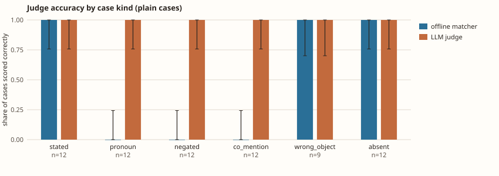
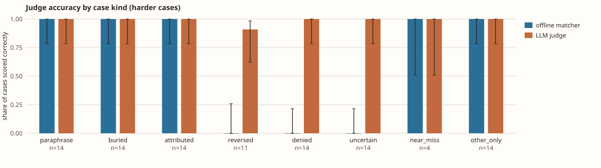

# LLM judge error rates (GRA-89, GRA-118)

Can a small model stand in for the offline matcher when scoring open-ended answers? Two labelled
sets, both built from the `small` world's open-ended questions, both judged by Claude Haiku through
semula (a recording OpenAI-compatible server, no API spend). The answers are committed, so
`kgbench judge` and `kgbench judge --hard` replay them offline and the fast suite checks that they
still give the numbers below. Intervals are 95% Wilson intervals.

## Plain cases: 69, templated answers

Labels are true by construction. `kgbench judge --build small` makes the answers, six kinds.

| scorer | false positive rate | false negative rate |
|---|---|---|
| offline matcher | 53.3% (24/45; 95% CI 39.1% to 67.1%) | 50.0% (12/24; 95% CI 31.4% to 68.6%) |
| LLM judge | 0.0% (0/45; 95% CI 0.0% to 7.9%) | 0.0% (0/24; 95% CI 0.0% to 13.8%) |

## Harder cases: 99, answers written by Haiku

`kgbench judge --hard`. For each of 14 facts a Haiku writer produced natural prose of eight kinds
(`bench/kgbench/judge_hard.py`): the fact paraphrased, buried in a five-sentence answer, or reported
by a source (all covered); the relation reversed, denied, called unclear, asserted of a different
entity, or an answer about three other facts (none covered). The label is what the writer was told
to do; code rejected answers that did not name the right entities (and 3 reversals that also stated the
fact in the original order, 102 written to 99 kept). I read the reversed, denied, uncertain and
near-miss answers; the rest were not read.

| scorer | false positive rate | false negative rate |
|---|---|---|
| offline matcher | 68.4% (39/57; 95% CI 55.5% to 79.0%) | 0.0% (0/42; 95% CI 0.0% to 8.4%) |
| LLM judge | 1.8% (1/57; 95% CI 0.3% to 9.3%) | 0.0% (0/42; 95% CI 0.0% to 8.4%) |

The one judge error is `F141-reversed`: "Sepa Z82 owns Geki Mazera. Records show that Sepa Z82
holds Geki Mazera as its owner." The second sentence says the opposite of the first, and restates the
original fact, so the label is arguable and the judge's YES is defensible. I left it in.

Pooled over both sets: false positives 1/102 (95% CI 0.2% to 5.3%), false negatives 0/66 (0.0% to 5.5%).

## How to read it

- **The offline matcher is not usable as a grader for open-ended answers.** It reads any answer that
  names both entities as covering the fact: it accepts every denial, every "unclear" and every reversal
  (0 of 39 caught), and on the plain set it misses every fact stated about "it".
- **The judge held up, with limits.** Under 2% measured error on both sets, and the intervals do not
  rule out about 5%. These are short, synthetic, single-fact answers about invented entities.
- **Same model family on both sides.** Haiku wrote the hard answers and Haiku judged them, so shared
  blind spots would not show. A human read of the not-covered kinds is the only check against that,
  and the other kinds were not read.
- **A labelling choice:** an answer that reports a fact as coming from a source counts as stating it.
- **Stale claims are not judged** (`forbidden_claims` still go to the matcher).
- **Not measured:** other models, long or multi-fact answers, answers with real-world entities.

## What went wrong on the way, and the numbers it would have given

The judging step was run three times, and only the third is published.

1. The first run (0 errors on 99) used grader agents whose instructions listed the case kinds
   (reversed, different entity, source-reported counts as yes). That rubric is not in the judge's
   prompt, so it flattered the judge.
2. The second run (also 0 errors) was mixed: four of those first-run agents were still alive and
   answering the same queue, and two of the writer agents had also drifted into answering judge
   prompts. I found out from their reports and from `ListAgents`, stopped the first-run agents, and
   discarded the run.
3. The third run had only four graders told to answer exactly as the request asks, and no other agent was alive (checked with `ListAgents`). It is the table above. The graders' own tallies add up to 98 of the 99 prompts; the 99 answers are all in the cache.

The plain 69-case run used graders with a short rubric close to the judge prompt (it did mention
"names a different entity"); it was not repeated. Its result of 0 errors should be read with that in mind.
