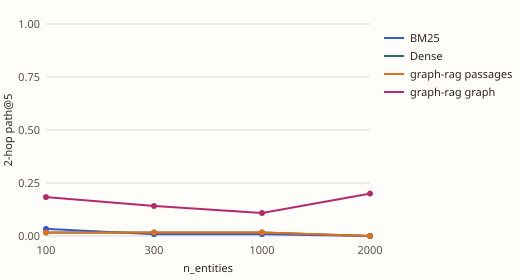
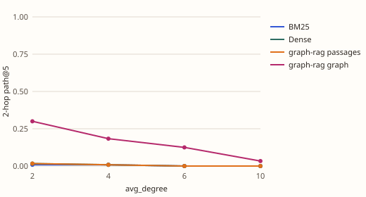
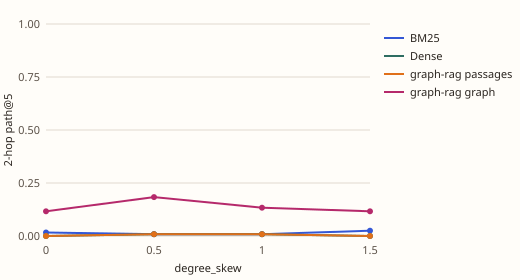
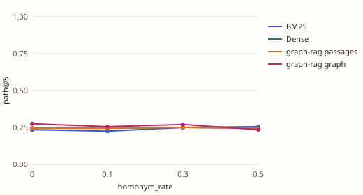
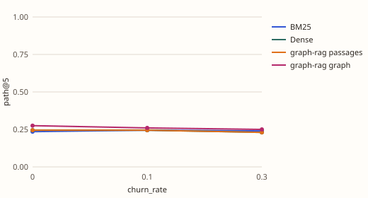
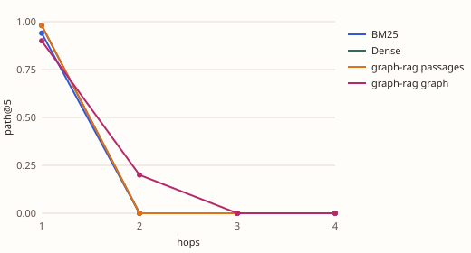

# Complexity sweeps: small worlds

Where does each retriever degrade as the graph gets harder? Each section changes one knob of the world, holds the rest at the base, and scores BM25, dense retrieval and graph-rag on generated questions. path@5 is the share of questions whose whole path is in the top 5 sentences.

## Setup

- Preset `small` with n_entities=500, world seeds [0, 1], every other knob at its base value.
- Embedder for the dense baseline and graph-rag: bge-small-en-v1.5 (local sentence-transformers).
- Reproduce: `uv run --extra embed kgbench sweep --knob all --preset small --set n_entities=500 --seeds 0 1 --questions 100 --embedder bge --k 5 --out docs/results/sweeps`
- A point counts as a win for graph-rag when its graph evidence beats the better baseline by at least 0.02 on path@5.

## Verdicts

- **n_entities**: graph-rag beat the baselines on path@5 only at 1000, 2000 of n_entities.
- **avg_degree**: graph-rag beat the baselines on path@5 up to 4 and stopped beating them from 6 on.
- **degree_skew**: graph-rag beat the baselines on path@5 up to 1 and stopped beating them from 1.5 on.
- **homonym_rate**: graph-rag beat the baselines on path@5 only at 0, 0.3 of homonym_rate.
- **churn_rate**: graph-rag beat the baselines on path@5 up to 0 and stopped beating them from 0.1 on.
- **hops**: graph-rag beat the baselines on path@5 only at 2 of hops.

## n_entities

| n_entities | questions | BM25 | Dense | graph-rag passages | graph-rag graph | margin |
|---|---|---|---|---|---|---|
| 100 | 200 | 0.25 / 0.50 | 0.26 / 0.52 | 0.26 / 0.52 | 0.27 / 0.50 | +0.01 |
| 300 | 200 | 0.23 / 0.49 | 0.26 / 0.51 | 0.26 / 0.51 | 0.25 / 0.50 | -0.01 |
| 1000 | 200 | 0.25 / 0.52 | 0.26 / 0.50 | 0.26 / 0.50 | 0.28 / 0.54 | +0.03 |
| 2000 | 200 | 0.24 / 0.50 | 0.25 / 0.49 | 0.25 / 0.49 | 0.29 / 0.50 | +0.04 |

Cells are path@5 / recall@5, means over seeds.

Worlds behind each point (realised, per seed):

| n_entities | seed | entities | facts | mean degree | max degree | shared names | replaced | retracted |
|---|---|---|---|---|---|---|---|---|
| 100 | 0 | 100 | 200 | 4.00 | 15 | 0 | 0 | 0 |
| 100 | 1 | 100 | 200 | 4.00 | 25 | 0 | 0 | 0 |
| 300 | 0 | 300 | 600 | 4.00 | 33 | 0 | 0 | 0 |
| 300 | 1 | 300 | 600 | 4.00 | 31 | 0 | 0 | 0 |
| 1000 | 0 | 1000 | 2000 | 4.00 | 44 | 0 | 0 | 0 |
| 1000 | 1 | 1000 | 2000 | 4.00 | 90 | 0 | 0 | 0 |
| 2000 | 0 | 2000 | 4000 | 4.00 | 132 | 0 | 0 | 0 |
| 2000 | 1 | 2000 | 4000 | 4.00 | 59 | 0 | 0 | 0 |

## avg_degree

| avg_degree | questions | BM25 | Dense | graph-rag passages | graph-rag graph | margin |
|---|---|---|---|---|---|---|
| 2 | 200 | 0.25 / 0.50 | 0.25 / 0.52 | 0.25 / 0.52 | 0.33 / 0.58 | +0.08 |
| 4 | 200 | 0.23 / 0.49 | 0.24 / 0.51 | 0.24 / 0.51 | 0.28 / 0.51 | +0.03 |
| 6 | 200 | 0.24 / 0.49 | 0.23 / 0.47 | 0.23 / 0.47 | 0.23 / 0.45 | -0.01 |
| 10 | 200 | 0.21 / 0.45 | 0.23 / 0.45 | 0.23 / 0.45 | 0.21 / 0.41 | -0.02 |

Cells are path@5 / recall@5, means over seeds.

Worlds behind each point (realised, per seed):

| avg_degree | seed | entities | facts | mean degree | max degree | shared names | replaced | retracted |
|---|---|---|---|---|---|---|---|---|
| 2 | 0 | 500 | 500 | 2.00 | 23 | 0 | 0 | 0 |
| 2 | 1 | 500 | 500 | 2.00 | 23 | 0 | 0 | 0 |
| 4 | 0 | 500 | 1000 | 4.00 | 34 | 0 | 0 | 0 |
| 4 | 1 | 500 | 1000 | 4.00 | 35 | 0 | 0 | 0 |
| 6 | 0 | 500 | 1500 | 6.00 | 55 | 0 | 0 | 0 |
| 6 | 1 | 500 | 1500 | 6.00 | 46 | 0 | 0 | 0 |
| 10 | 0 | 500 | 2500 | 10.00 | 82 | 0 | 0 | 0 |
| 10 | 1 | 500 | 2500 | 10.00 | 64 | 0 | 0 | 0 |

## degree_skew

| degree_skew | questions | BM25 | Dense | graph-rag passages | graph-rag graph | margin |
|---|---|---|---|---|---|---|
| 0 | 200 | 0.23 / 0.48 | 0.24 / 0.50 | 0.24 / 0.50 | 0.28 / 0.51 | +0.03 |
| 0.5 | 200 | 0.23 / 0.49 | 0.24 / 0.51 | 0.24 / 0.51 | 0.28 / 0.51 | +0.03 |
| 1 | 200 | 0.25 / 0.51 | 0.25 / 0.52 | 0.25 / 0.52 | 0.28 / 0.54 | +0.03 |
| 1.5 | 200 | 0.26 / 0.52 | 0.25 / 0.52 | 0.25 / 0.52 | 0.27 / 0.51 | +0.01 |

Cells are path@5 / recall@5, means over seeds.

Worlds behind each point (realised, per seed):

| degree_skew | seed | entities | facts | mean degree | max degree | shared names | replaced | retracted |
|---|---|---|---|---|---|---|---|---|
| 0 | 0 | 500 | 1000 | 4.00 | 14 | 0 | 0 | 0 |
| 0 | 1 | 500 | 1000 | 4.00 | 18 | 0 | 0 | 0 |
| 0.5 | 0 | 500 | 1000 | 4.00 | 34 | 0 | 0 | 0 |
| 0.5 | 1 | 500 | 1000 | 4.00 | 35 | 0 | 0 | 0 |
| 1 | 0 | 500 | 1000 | 4.00 | 92 | 0 | 0 | 0 |
| 1 | 1 | 500 | 1000 | 4.00 | 99 | 0 | 0 | 0 |
| 1.5 | 0 | 500 | 1000 | 4.00 | 138 | 0 | 0 | 0 |
| 1.5 | 1 | 500 | 1000 | 4.00 | 118 | 0 | 0 | 0 |

## homonym_rate

| homonym_rate | questions | BM25 | Dense | graph-rag passages | graph-rag graph | margin |
|---|---|---|---|---|---|---|
| 0 | 200 | 0.23 / 0.49 | 0.24 / 0.51 | 0.24 / 0.51 | 0.28 / 0.51 | +0.03 |
| 0.1 | 200 | 0.23 / 0.47 | 0.24 / 0.50 | 0.24 / 0.50 | 0.26 / 0.50 | +0.01 |
| 0.3 | 200 | 0.25 / 0.50 | 0.25 / 0.51 | 0.25 / 0.51 | 0.27 / 0.49 | +0.02 |
| 0.5 | 200 | 0.26 / 0.50 | 0.24 / 0.50 | 0.24 / 0.50 | 0.23 / 0.48 | -0.02 |

Cells are path@5 / recall@5, means over seeds.

Worlds behind each point (realised, per seed):

| homonym_rate | seed | entities | facts | mean degree | max degree | shared names | replaced | retracted |
|---|---|---|---|---|---|---|---|---|
| 0 | 0 | 500 | 1000 | 4.00 | 34 | 0 | 0 | 0 |
| 0 | 1 | 500 | 1000 | 4.00 | 35 | 0 | 0 | 0 |
| 0.1 | 0 | 500 | 1000 | 4.00 | 34 | 50 | 0 | 0 |
| 0.1 | 1 | 500 | 1000 | 4.00 | 35 | 50 | 0 | 0 |
| 0.3 | 0 | 500 | 1000 | 4.00 | 34 | 150 | 0 | 0 |
| 0.3 | 1 | 500 | 1000 | 4.00 | 35 | 150 | 0 | 0 |
| 0.5 | 0 | 500 | 1000 | 4.00 | 34 | 250 | 0 | 0 |
| 0.5 | 1 | 500 | 1000 | 4.00 | 35 | 250 | 0 | 0 |

## churn_rate

| churn_rate | questions | BM25 | Dense | graph-rag passages | graph-rag graph | margin |
|---|---|---|---|---|---|---|
| 0 | 200 | 0.23 / 0.49 | 0.24 / 0.51 | 0.24 / 0.51 | 0.28 / 0.51 | +0.03 |
| 0.1 | 200 | 0.24 / 0.50 | 0.24 / 0.50 | 0.24 / 0.50 | 0.26 / 0.49 | +0.02 |
| 0.3 | 200 | 0.24 / 0.48 | 0.23 / 0.48 | 0.23 / 0.48 | 0.25 / 0.48 | +0.01 |

Cells are path@5 / recall@5, means over seeds.

Worlds behind each point (realised, per seed):

| churn_rate | seed | entities | facts | mean degree | max degree | shared names | replaced | retracted |
|---|---|---|---|---|---|---|---|---|
| 0 | 0 | 500 | 1000 | 4.00 | 34 | 0 | 0 | 0 |
| 0 | 1 | 500 | 1000 | 4.00 | 35 | 0 | 0 | 0 |
| 0.1 | 0 | 500 | 1100 | 4.00 | 34 | 0 | 100 | 0 |
| 0.1 | 1 | 500 | 1100 | 4.00 | 35 | 0 | 100 | 0 |
| 0.3 | 0 | 500 | 1300 | 4.00 | 34 | 0 | 300 | 0 |
| 0.3 | 1 | 500 | 1300 | 4.00 | 35 | 0 | 300 | 0 |

## hops

| hops | questions | BM25 | Dense | graph-rag passages | graph-rag graph | margin |
|---|---|---|---|---|---|---|
| 1 | 50 | 0.94 / 0.94 | 0.98 / 0.98 | 0.98 / 0.98 | 0.90 / 0.90 | -0.08 |
| 2 | 50 | 0.00 / 0.48 | 0.00 / 0.50 | 0.00 / 0.50 | 0.20 / 0.59 | +0.20 |
| 3 | 50 | 0.00 / 0.31 | 0.00 / 0.33 | 0.00 / 0.33 | 0.00 / 0.31 | +0.00 |
| 4 | 50 | 0.00 / 0.25 | 0.00 / 0.23 | 0.00 / 0.23 | 0.00 / 0.23 | +0.00 |

Cells are path@5 / recall@5, means over seeds.

## Caveats

- Templated text with made-up names; graph-rag is the offline pipeline (see the compare report's caveats). A knob that moves the result here may not move it on real prose.
- Questions are plain entity questions. Each point has few questions per seed, so gaps under 0.02 are noise; the margin column shows how far each point is from that.
